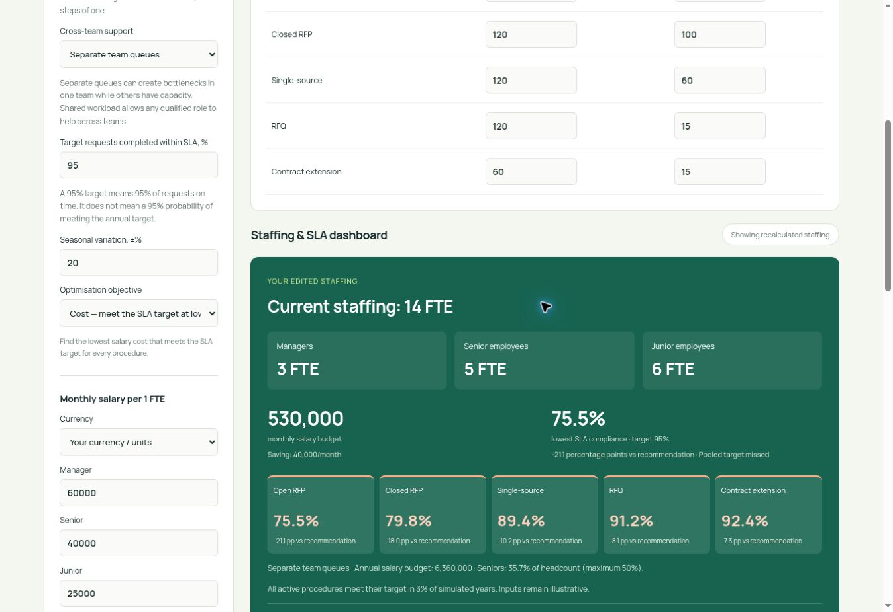

# GitHub Pages verification — 15 October 2026

Live calculator: https://ukrsedo.github.io/procurement-team-calculator/

Desktop browser checks passed on the deployed calculator:

- Default recommendation: 3 managers, 6 senior employees, 6 junior employees; 15 FTE; monthly salary budget 570,000; lowest pooled SLA compliance 96.6%.
- Removing one senior employee updates the main dashboard automatically: 14 FTE; monthly salary budget 530,000; Open RFP compliance 75.5%.
- Reset restores 15 FTE, 570,000 and 96.6%.
- Setting junior FTEs to zero makes senior headcount 66.7%; the main dashboard rejects the scenario, explains the 50% limit and does not calculate SLA.

These checks verify desktop interaction and deployment, not historical calibration or operational accuracy. Mobile layouts were not tested. The original audit report records the earlier audit stage; these rendered-browser checks were performed subsequently during the GitHub migration.
